# Contribution

## 📊 GitHub 统计

  
  

<!-- 卡片为仓库内静态 SVG，由 .github/workflows/stats.yml 每日刷新；不依赖 Vercel / PAT / 任何第三方图片服务 -->

## 🔥 提交统计

## 🐍 贡献贪吃蛇

每日提交量以贡献格子的形式展示，小蛇会把一年的提交全部"吃"一遍。

<picture>
  <source media="(prefers-color-scheme: dark)" srcset="https://raw.githubusercontent.com/neokill01/neokill01/output/github-contribution-grid-snake-dark.svg">
  <source media="(prefers-color-scheme: light)" srcset="https://raw.githubusercontent.com/neokill01/neokill01/output/github-contribution-grid-snake.svg">
  
</picture>
